  
  

**B.E. Information Science & Engineering · 2nd Year · Bengaluru, India**

8.1 / 10 CGPA &nbsp; · &nbsp; Backend Development Intern — Decode Labs

---

## 01 / About

I'm Abhishek, an Information Science and Engineering student interested in building useful software at the intersection of **backend engineering and applied AI**.

I enjoy turning problem statements into working prototypes — designing APIs, connecting databases, experimenting with computer vision, and testing the edge cases that make software dependable.

- Currently strengthening **Java, Data Structures & Algorithms, and backend engineering**.
- Building with **Python, Flask, SQLAlchemy, REST APIs, and computer vision**.
- Exploring practical AI systems, document workflows, and developer tools.
- Interested in software engineering internships, hackathons, and collaborative builds.

## 02 / Selected work

A small selection of projects that reflect what I enjoy building. Project links lead to their source repositories.

<table>
<tr>
<td width="50%" valign="top">

### 01 · MerchantMitra
**Retail operations, simplified.**

A retail operations prototype bringing together point-of-sale billing, inventory, customer workflows, business insights, campaigns, and a multilingual assistant.

Python · FastAPI · React · TypeScript · SQLite

[Explore repository →](https://github.com/abhishekbagi262/Merchant_Mitra)

</td>
<td width="50%" valign="top">

### 02 · AuthenIQ
**Evidence-led document review.**

A browser-based application-validation prototype with local document extraction, preliminary checks, simulated source-verification scenarios, officer review, and an audit trail.

HTML · CSS · JavaScript · PDF.js · Tesseract.js

[Explore repository →](https://github.com/abhishekbagi262/AuthenIQ)

</td>
</tr>
<tr>
<td width="50%" valign="top">

### 03 · APAAR-Connect
**Student data validation workflows.**

A student data management and verification project exploring structured intake, validation rules, duplicate detection, and audit-oriented workflows.

[Explore repository →](https://github.com/abhishekbagi262/APAAR-ID---AuthenIQ)

</td>
<td width="50%" valign="top">

### 04 · Database CRUD API
**Backend fundamentals, implemented.**

A Flask REST API with SQLite persistence, SQLAlchemy ORM, complete CRUD operations, input validation, and duplicate-email prevention.

Python · Flask · SQLAlchemy · SQLite

[Explore repository →](https://github.com/abhishekbagi262/backend-project-2-database-crud)

</td>
</tr>
<tr>
<td width="50%" valign="top">

### 05 · NOVA
**A desktop assistant you can talk to and gesture at.**

A locally powered voice assistant exploring conversational context, Gemma through Ollama, OpenCV, MediaPipe hand tracking, and desktop control.

Python · Gemma 3 · Ollama · OpenCV · MediaPipe

[Explore repository →](https://github.com/abhishekbagi262/NOVA)

</td>
<td width="50%" valign="top">

### 06 · Reality Check AI
**Visual evidence, with uncertainty made explicit.**

A multimodal visual investigation prototype designed to separate visible evidence, hypotheses, uncertainty, and human verification.

Python · Streamlit · Gemma 4

[Explore repository →](https://github.com/abhishekbagi262/Reality_Check)

</td>
</tr>
</table>

## 03 / Experience

**Backend Development Intern — Decode Labs**

Working through practical backend development tasks involving Python, REST API design, CRUD operations, and database integration.

**Technical focus:** API development · Data persistence · Request validation · SQLAlchemy · SQLite

## 04 / Hackathons & developer community

- **Paytm Build for India AI Hackathon — Bengaluru Edition:** Participated in a build focused on practical AI applications.
- **ISRO Bharatiya Antariksh Hackathon 2026:** Explored generative-AI-based cloud removal and reconstruction for LISS-IV satellite imagery with team TECH BADGERS.
- **Atria Hacktoberfest 2026:** Worked on a Gemma-track prototype exploring AI-assisted notice analysis.
- **AWS Builder Center — Future Builders Connect:** Participated in cloud and AI community learning.

## 05 / Technology I work with

**LANGUAGES**

**BACKEND & DATA**

**AI, COMPUTER VISION & TOOLS**

*Technologies shown reflect my current project work and learning areas; proficiency varies by tool.*

## 06 / GitHub activity

### Contribution calendar

These visualizations depend on third-party services and GitHub's publicly available activity data. Language cards describe repository/commit language distribution, not a measure of skill. If a service is unavailable, the cards may not render.

## 07 / Outside the editor

I like learning by building, exploring unfamiliar technologies, participating in developer events, and collaborating with people who enjoy solving real problems.

### HAVE A PROBLEM WORTH BUILDING FOR?

**Let's connect and make something useful.**

while (curious) { build(); learn(); iterate(); }

