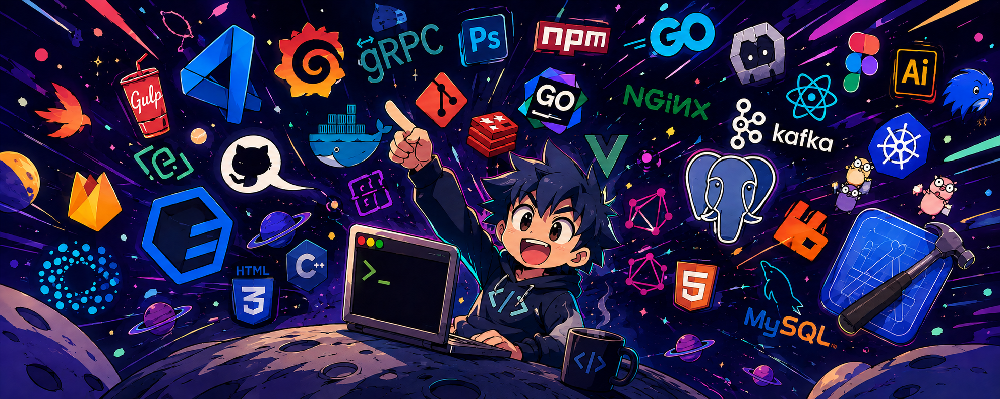

# Hi, I'm Abhishek Bagi 👋

### ISE Student · Backend Developer · AI Builder

**Bengaluru, India** · B.E. Information Science & Engineering · Class of 2028

---

## About

I'm a second-year Information Science and Engineering student interested in building practical software at the intersection of **backend engineering and applied AI**.

I work on Python-based applications, REST APIs, database-backed systems and AI prototypes. I enjoy taking a problem from an initial idea through implementation, testing and documentation—and learning from each iteration.

- **Currently focused on:** Java and Data Structures & Algorithms, backend development, and applied AI.
- **Experience:** Backend Development Intern at Decode Labs.
- **Academic record:** 8.1 / 10.0 CGPA.
- **Based in:** Bengaluru, India.

## Technology Stack

**Languages**

**Backend & Databases**

**AI, Computer Vision & Tools**

## Featured Projects

<table>
<tr>
<td width="50%" valign="top">

### 🔎 Reality Check AI

A visual investigation and asset-management prototype using Gemma 4 multimodal vision. Separates visible evidence, hypotheses and uncertainty, with human verification in the workflow.

**Focus:** Python · Streamlit · Gemma 4 · Multimodal AI

[View repository →](https://github.com/abhishekbagi262/Reality_Check)

</td>
<td width="50%" valign="top">

### 🛡️ AuthenIQ

A browser-based AICTE application validation and regulatory decision-support prototype for SIH 2026 PS 26261. Emphasizes evidence-led checks and human review.

**Focus:** JavaScript · PDF.js · Tesseract.js · Validation workflows

[View repository →](https://github.com/abhishekbagi262/AuthenIQ)

</td>
</tr>
<tr>
<td width="50%" valign="top">

### 🎓 APAAR-Connect

A student data management and verification prototype exploring admission validation, intake monitoring, audit trails and privacy-aware verification using synthetic data.

**Focus:** React · TypeScript · Spring Boot · PostgreSQL

[View repository →](https://github.com/abhishekbagi262/APAAR-ID---AuthenIQ)

</td>
<td width="50%" valign="top">

### 🧾 MerchantMitra

An AI-powered retail operating-system concept for local retailers, bringing together billing, inventory, customer workflows and a multilingual business copilot.

**Focus:** Retail technology · AI-assisted workflows

[View repository →](https://github.com/abhishekbagi262/Merchant_Mitra)

</td>
</tr>
<tr>
<td width="50%" valign="top">

### ⚙️ Flask REST API

A backend learning project implementing REST endpoints and user-related operations with Flask.

**Focus:** Python · Flask · REST APIs

[View repository →](https://github.com/abhishekbagi262/backend-project-1-rest-api)

</td>
<td width="50%" valign="top">

### 🗄️ Database CRUD API

A backend project focused on database integration and CRUD operations using Flask and SQLAlchemy.

**Focus:** Python · Flask · SQLAlchemy · SQLite

[View repository →](https://github.com/abhishekbagi262/backend-project-2-database-crud)

</td>
</tr>
</table>

## Experience & Learning

- **Backend Development Intern — Decode Labs:** Working on Python backend development, REST APIs and database-backed applications.
- **ISRO Bharatiya Antariksh Hackathon 2026:** Worked on a concept for generative-AI-based cloud removal and reconstruction for LISS-IV satellite imagery.
- **Continuous learning:** Strengthening Java, DSA, database fundamentals, backend architecture and AI engineering.

## GitHub Activity

 

 

Statistics and activity cards are provided by external services and may occasionally be unavailable or delayed.

## Let's Connect

I'm interested in connecting with developers, mentors and teams working on software engineering, backend systems and applied AI.

“Build with curiosity. Improve with evidence. Ship with purpose.”

